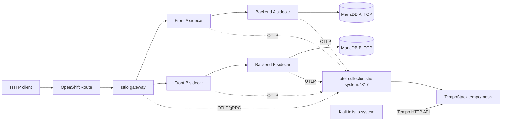

# full-multi · Kiali and Tempo tracing integration

This change targets the existing `full-multi` namespace and **does not install or
replace** the shared Service Mesh (`Istio/default`), OpenTelemetry Collector,
TempoStack or Kiali operator. The six Rollouts remain independent and their
BLUE/YELLOW revision markers are preserved.

## Trace topology and scope



`Telemetry/full-multi-tracing` already selects provider `otel-tracing` at
**100%** sampling for the `full-multi` namespace. The provider must exist in
`Istio/default.spec.values.meshConfig.extensionProviders` and use the real
Collector service/port; on this cluster that was previously reported as
`otel-collector.istio-system.svc.cluster.local:4317`.

This patch adds a `PodMonitor` for Istio proxy HTTP metrics so that Kiali has
mesh traffic information **if** OpenShift user-workload monitoring is enabled
and the Kiali Prometheus data source can query those metrics. Metrics do not
replace distributed traces.

The adapted Bookshelf Front must explicitly propagate `traceparent`,
`tracestate`, `baggage`, `x-request-id`, `b3`, and the B3 family of headers to
Backend; the patch adds this alongside `x-backend-track`, `x-db-track` and
`x-app-target`. This allows Envoy-generated Front/Backend spans to be assembled
under a consistent trace ID instead of appearing as unconnected traces.

**Database limitation:** Istio traces HTTP/gRPC through the Envoy proxies;
MariaDB uses TCP and this patch does **not** add SQL statement spans. The TCP
connection can appear in Kiali's traffic metrics graph, but a per-query SQL
span requires separate OpenTelemetry instrumentation of the Backend's SQL
client. Do not assert that a six-span, three-tier end-to-end trace exists until
explicitly verified.

## Installation

From the `argo-sm` repository root:

```bash
unzip -n ~/Downloads/argo_sm_full_multi_observability_patch.zip -d .
python3 scripts/install_full_multi_observability.py

gofmt -w full-multi/bookshelf/main.go full-multi/bookshelf/main_test.go

# Reuse the Go 1.25 Podman builder (not the Go 1.23 host toolchain).
podman run --rm --userns=keep-id \
  -e GOPATH=/tmp/gopath -e GOCACHE=/tmp/gocache \
  -v "$PWD/full-multi/bookshelf:/src:Z" -w /src \
  docker.io/library/golang:1.25-alpine \
  sh -ec 'go test -mod=readonly ./...'

python3 scripts/full-multi-spec.py verify
bash -n scripts/build-push-full-multi.sh
bash -n scripts/check-full-multi-tracing.sh
python3 -m py_compile scripts/full-multi-kiali-tempo.py
oc kustomize full-multi >/tmp/full-multi-observability-render.yaml
```

**Build and push the updated shared image before committing rollout manifests.**
This patch intentionally changes the four Front/Backend image references to
`ghcr.io/gstephan76/argo-sm-bookshelf:full-multi-tracing-v2` and changes the
build script's default tag. Both MariaDB images and all six Rollout lifecycle
contracts stay unchanged.

```bash
bash scripts/build-push-full-multi.sh
skopeo inspect --no-creds \
  docker://ghcr.io/gstephan76/argo-sm-bookshelf:full-multi-tracing-v2

git add full-multi/ scripts/build-push-full-multi.sh \
  scripts/full-multi-spec.py scripts/check-full-multi-tracing.sh \
  scripts/full-multi-kiali-tempo.py scripts/install_full_multi_observability.py
git diff --cached --check
git commit -m 'Integrate full-multi Istio traces with Kiali and Tempo'
git push origin main
```

Argo CD automatically syncs `full-multi` from `main`. Rolling out a new Front/
Backend image can involve the existing analysis gates and a final manual pause.
**Do not assume that updating the image automatically promotes the canaries**;
inspect all six Rollouts and use your existing `INSTANCE=a|b` workflow when
appropriate. Do not wipe database storage.

## Configure shared Kiali (separate platform ownership)

Kiali does **not** read its tracing backend from `Telemetry` resources.
The central `Kiali` CR needs an explicit connection to the Tempo HTTP API.
The exact tenant and Kiali CR name cannot be inferred from the existing
`full-multi` repo. Never put a guessed `X-Scope-OrgID` tenant into manifests.

First determine the TempoStack tenancy and Kiali resource:

```bash
oc get kialis.kiali.io -A
oc get tempostack mesh -n tempo -o json | jq '{tenants:.spec.tenants}'
oc -n istio-system get kiali kiali -o json | jq '.spec.external_services.tracing'
```

Choose the **real Tempo tenant** that receives the Collector's traces. Check
that the Collector's exporter and tenant routing match it. Preview the Kiali
merge patch without changing the cluster:

```bash
python3 scripts/full-multi-kiali-tempo.py --tenant <TENANT_NAME>
```

When satisfied, and only if you own the Kiali configuration, run:

```bash
python3 scripts/full-multi-kiali-tempo.py --tenant <TENANT_NAME> --apply
```

If Kiali already uses a different tracing configuration, the helper will
refuse to change it. Review its current settings and, only if deliberate,
append `--replace-existing`. It preserves other Kiali fields (Prometheus,
Grafana, deployment settings) through a JSON merge patch. A central GitOps
controller may revert an imperative patch: place the same tracing settings in
the **actual Kiali installation's GitOps source**. Do **not** add an entire
Kiali CR to the `full-multi` Argo CD Application, as that would create
competing resource ownership.

The helper uses `provider: tempo`, `url_format: openshift`,
`external_url: https://<OpenShift-console-host>` and the Tempo gateway's
HTTPS `/api/traces/v1/<tenant>/tempo` API. It uses Kiali's ServiceAccount
bearer token, not a hardcoded token, and enables TLS verification. Access
requires network reachability, suitable Tempo tenant authorizations for Kiali,
and trust for the Tempo gateway's serving CA. If your Kiali operator/version
uses different API fields, review its CRD before applying.

Official Kiali reference:
https://kiali.io/docs/configuration/external-services/tracing/tempo/

## Diagnose Collector and Tempo

```bash
bash scripts/check-full-multi-tracing.sh

# Terminal 1: expose Collector self-metrics
oc -n istio-system port-forward svc/otel-collector-monitoring 18888:8888

# Terminal 2: collect counters before/after a traffic run
curl -fsS http://localhost:18888/metrics | grep -E \
 '^otelcol_(receiver_accepted_spans|exporter_sent_spans|exporter_send_failed_spans)'

INSTANCE=a REQUESTS=100 bash scripts/full-multi.sh traffic
INSTANCE=b REQUESTS=100 bash scripts/full-multi.sh traffic

oc -n istio-system logs deployment/otel-collector --since=10m | \
  grep -Ei 'export|error|fail|tenant|unauthoriz|tempo' | tail -60
```

Trace the path:

1. Confirm ingress and Front/Backend Pods actually contain `istio-proxy`.
2. Confirm Envoy config includes an OTLP tracing cluster and the namespace
   Telemetry policy is selected (root mesh default alone is insufficient).
3. Confirm Collector *accepted* and *sent* span counters rise during traffic.
4. Confirm the selected Tempo tenant receives and can query those spans.
5. Confirm Kiali can query the same Tempo tenant, then select `full-multi`
   in Kiali, view the traffic graph and workload **Traces** tabs.
6. Search the time window without filtering for `front-a`: service names may
   come from Istio's workload attributes and differ from Rollout names.

A ready Collector or TempoStack alone doesn't prove end-to-end delivery.
With 100% sampling, HTTP traffic should cause spans to arrive if the complete
pipeline is working. Actual results depend on live routing, authorization and
collector exporter configuration.

## Non-goals and safety

- No change to the cluster-wide sampling policy or Istio control-plane CR.
- No new shared Collector or TempoStack, and no unverified tenant assignment.
- No automatic Kiali CR overwrite in the application Argo CD sync.
- No SQL statement tracing without additional application instrumentation.
- No change to A/B header-selection behavior, database passwords or MariaDB
  blue-green storage semantics.
