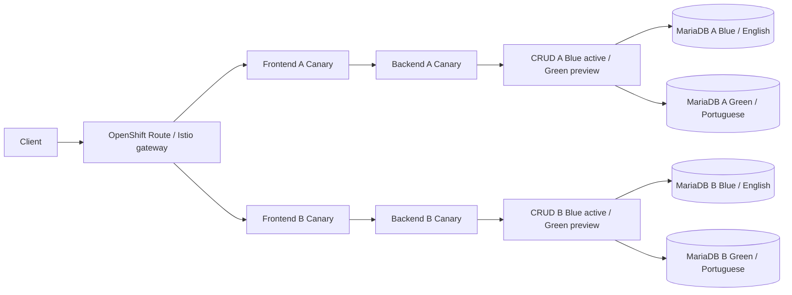

# multi-ambient observability

This document covers the existing Istio, OpenTelemetry, Tempo and Kiali
integration. It does **not** create or replace shared observability operators.



Applications A and B have separate application identities in the same
`multi-ambient` namespace, with four distinct MariaDB StatefulSet/PVC pairs.
Headers select paths via Istio; SQL connections use TCP.

The projected `bookshelf-release-theme` ConfigMap controls Frontend/Backend
appearance; the Go HTTP tiers propagate `traceparent`, `tracestate`, `baggage`,
`x-request-id`, and B3 headers so gateway and waypoint traces can correlate requests.
`Telemetry/full-multi-tracing` selects the `otel-tracing` provider, which must
be configured in the shared Istio control plane. `PodMonitor` selects injected gateway and waypoint proxies when their scrape annotations are present. ZTunnel metrics are a shared-platform responsibility. Verify actual scrape targets after deployment. MariaDB TCP traffic alone
does **not** supply SQL query spans.

## Reading the Kiali graph in ambient mode

For a concrete path, select the `multi-ambient` namespace and **Workload
graph**, then issue a request through the `multi-ambient` OpenShift Route:

```bash
HOST="$(oc -n multi-ambient get route multi-ambient -o jsonpath='{.spec.host}')"
curl -kfsS \
  -H 'x-app-target: a' \
  -H 'x-front-track: stable' \
  -H 'x-backend-track: stable' \
  -H 'x-db-track: blue' \
  "https://${HOST}/api/books" | jq
```

The intended path is `full-multi-gateway-istio` → `front-a-stable` /
`front-a` → `backend-a-stable` / `backend-a` → `crud-a-blue` / `crud-a` →
`mariadb-a-blue`. The Service names identify routing destinations; the
workload names identify the components serving traffic. The front and backend
stable/canary selections are independent of the CRUD blue/green database
selection. The response includes the actual frontend, backend, CRUD and database
identity; inspect it rather than inferring the selected revision from the
workload graph alone.

The graph can show `mariadb-a-blue` twice: the triangle is the headless
Kubernetes Service, and the circle is the StatefulSet workload. They are not
two databases. Check the Service's current endpoints with:

```bash
oc -n multi-ambient get endpointslices.discovery.k8s.io \
  -l kubernetes.io/service-name=mariadb-a-blue
```

In ambient mode, waypoint proxies report HTTP telemetry and ztunnel reports TCP
telemetry. Kiali may therefore show green HTTP and blue TCP edges for the same
HTTP path. Parallel edges alone do not prove duplicate application requests.
Use **Traffic** to select waypoint or ztunnel telemetry; keep TCP/ztunnel
visible when examining MariaDB connections. **Display → Service Nodes** can
show or hide intermediate Services. See [Kiali's ambient telemetry guide](https://kiali.io/docs/features/ambient/) and
[graph FAQ](https://kiali.io/docs/faq/graph/).

Kiali aggregates metrics over the selected time window, so a graph can contain
background or earlier traffic in addition to the example request. A direct TCP
edge from `crud-a` to the database workload can have destination service
`unknown`, while another edge passes through the Service node. Inspect each
edge's protocol, reporter and destination labels; the graph alone cannot prove
whether those edges represent duplicate observations or separate connections.
SQL query contents are not visible from TCP mesh metrics. Use traces and
application/database evidence when request-level attribution is required.

Inspect the existing pipeline without changing shared platform resources:

```bash
bash scripts/check-full-multi-tracing.sh
oc -n multi-ambient get telemetry full-multi-tracing -o yaml
oc get kiali -A
oc -n tempo get tempostack
```

`scripts/full-multi-kiali-tempo.py` is a separately authorized administrative
helper and does not run as part of the application GitOps sync. Use its
read-only plan mode first, and supply the real Tempo tenant. Do not invent
`X-Scope-OrgID`, replace a shared Kiali CR, or re-run legacy source-code
installer scripts. The application tracing code is already integrated.

Acceptance: verify 2xx responses for all four Blue/Green paths, Kiali workload
metrics, trace export counters, tenant routing, and retrieval from Tempo.

The optional `full-multi-otel-k8sattributes.py` and its RBAC manifest target
`multi-ambient` and the shared Collector. They do not run as part of this
deployment; inspect the existing Collector configuration before using them.
