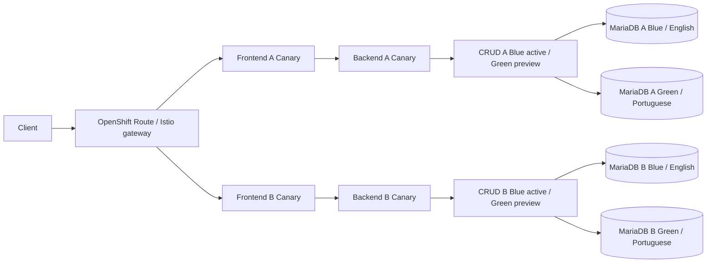

# full-multi observability (current topology)

This document covers the existing Istio, OpenTelemetry, Tempo and Kiali
integration. It does **not** create or replace shared observability operators.



A and B use separate namespaces of application identity and four distinct
MariaDB StatefulSet/PVC pairs, even though the source code and seeded catalogs
are equivalent. Headers select paths via Istio; SQL connections are native TCP.

The projected `bookshelf-release-theme` ConfigMap controls Frontend/Backend
appearance; the Go HTTP tiers propagate `traceparent`, `tracestate`, `baggage`,
`x-request-id`, and B3 headers so Istio proxy traces can correlate requests.
`Telemetry/full-multi-tracing` selects the `otel-tracing` provider, which must
be configured in the shared Istio control plane. `PodMonitor` collects proxy
metrics where user-workload monitoring is enabled. MariaDB TCP traffic alone
does **not** supply SQL query spans.

Inspect the existing pipeline without changing shared platform resources:

```bash
bash scripts/check-full-multi-tracing.sh
oc -n full-multi get telemetry full-multi-tracing -o yaml
oc get kiali -A
oc -n tempo get tempostack
```

`scripts/full-multi-kiali-tempo.py` is a separately authorized administrative
helper and does not run as part of the application GitOps sync. Use its
read-only plan mode first, and supply the real Tempo tenant. Do not invent
`X-Scope-OrgID`, replace a shared Kiali CR, or re-run legacy source-code
installer scripts. The application tracing code is already integrated.

Acceptance: verify 2xx responses for all four Blue/Green paths, Kiali workload
metrics, trace export counters, tenant routing, and retrieval from Tempo.
