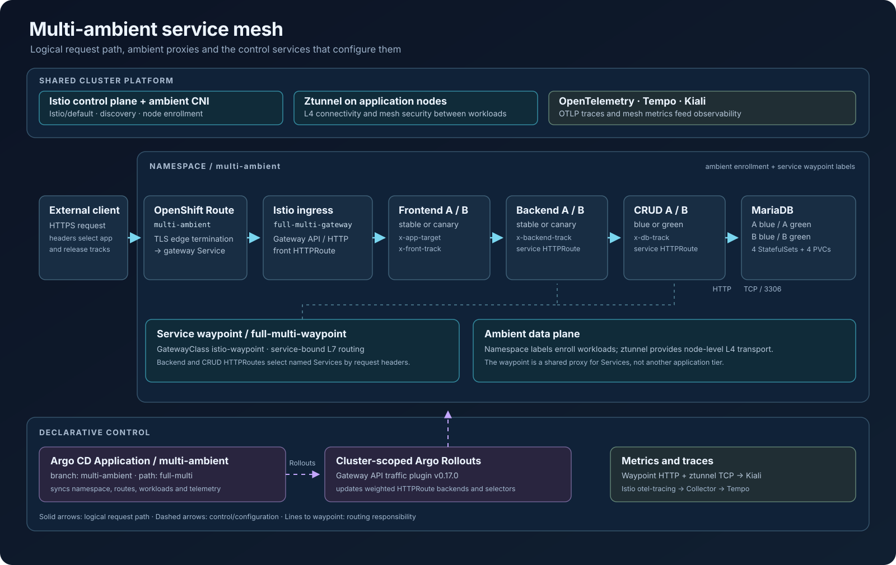

# full-multi — two isolated applications, six Rollouts, four MariaDB databases

This branch defines the **ambient-mode** OpenShift GitOps topology. See [AMBIENT.md](AMBIENT.md) for prerequisites and deployment. Application A and B use the
same demonstration code and the same book catalogs, but **never share** a database,
StatefulSet, Service, PVC or SQL connection. Frontend/Backend have independent
Argo Rollouts Canary strategies, while CRUD-A/B have native Argo Rollouts
BlueGreen strategies.

## How ambient mode is configured

The ambient version reuses the cluster's Service Mesh and observability stack.
The `multi-ambient` Argo CD Application tracks the `multi-ambient` branch and
renders the `full-multi` directory into the `multi-ambient` namespace. The
repository directory and some existing resources retain their `full-multi`
names; the OpenShift Route and destination namespace are both `multi-ambient`.



The diagram shows the logical request path. The waypoint is shared by enrolled
Services; it is not another application tier. The repository configures the
application boundary as follows:

1. **Enroll the namespace.** [namespace.yaml](namespace.yaml) sets
   `istio.io/dataplane-mode: ambient`, enables mesh discovery, selects
   `full-multi-waypoint`, and grants management to the `openshift-gitops`
   Argo CD instance. Application Pods do not request sidecar injection.
   Ztunnel on each application node provides the ambient L4 data plane.
2. **Create ingress and L7 routing.** The OpenShift
   [Route](route.yaml) terminates TLS at the edge and forwards to the
   Service generated for [Gateway/full-multi-gateway](gateway.yaml).
   [front-httproute.yaml](front-httproute.yaml) selects application A or B
   and the Frontend stable/canary Service from the request headers. The
   [service waypoint](waypoint.yaml), using `istio-waypoint` and HBONE,
   supports the Service-attached Backend and CRUD HTTPRoutes. Those routes
   select the corresponding Backend and CRUD Services using
   `x-backend-track` and `x-db-track`. Without a CRUD track header, the
   CRUD route selects the active Service.
3. **Keep traffic control with Argo Rollouts.** A cluster-scoped
   RolloutManager uses the `argoproj-labs/gatewayAPI` plugin at `v0.17.0`.
   The Frontend and Backend canaries reference their HTTPRoutes and let the
   plugin update stable/canary weights. CRUD uses a BlueGreen strategy with
   explicit promotion. The Argo CD Application ignores the
   Rollouts-managed Service hash selectors and HTTPRoute weights, while
   retaining the rest of each resource in GitOps. Namespace-scoped roles
   give the Rollouts controller access to Services and HTTPRoutes and the
   GitOps controller access to Gateways.
4. **Reuse tracing and metrics.** [telemetry.yaml](telemetry.yaml) selects
   the existing `otel-tracing` provider. The gateway and waypoint provide
   HTTP telemetry, while ztunnel provides TCP telemetry. Kiali can display
   both; the OpenTelemetry Collector exports traces to Tempo. See
   [OBSERVABILITY.md](OBSERVABILITY.md) for the Kiali graph and trace checks.

On the cluster used for this deployment, `Istio/default` was verified with the
`ambient` profile, discovery selector `istio-discovery=enabled`, tracing
provider `otel-tracing`, and `ENABLE_INGRESS_WAYPOINT_ROUTING=true`. The
ambient CNI and ztunnel are installed in `istio-cni` and `ztunnel`,
respectively. These are shared platform settings; the application manifests do
not install or change them. OVN-Kubernetes uses `routingViaHost: true` so
ambient workload probes can reach Pods through the host. Changing that setting
is cluster-wide and can disrupt traffic during reconciliation.

Install prerequisites and prepare both applications with one command:

```bash
scripts/full-multi prepare
```

`prepare` checks and configures OVN local gateway mode, installs or reconciles
GitOps, Rollouts, the console plugin and namespace RBAC, generates missing demo
credentials, provisions the four databases, deploys GitOps and establishes the
Blue baseline with E2E checks. Every stage must succeed before the next begins.
It can change cluster-wide OVN routing, commit and push Blue templates, and
reset rollout history. Do not run it to preserve a paused demonstration.
The scripts preserve existing Secrets and PVCs, and refuse conflicting
prerequisite resources. See [GLOBAL-WORKFLOWS.md](GLOBAL-WORKFLOWS.md) for
preconditions, recovery and verification, and [AMBIENT.md](AMBIENT.md) for
the deployment boundaries. Reuse the same command after an interruption:
transient reads and status-only patch races have bounded retries, and existing
credentials and storage are preserved. A missing demo Secret is generated only
before its app has storage or workloads. GitOps sync and local tests alone do not prove
working traffic, telemetry collection or trace retrieval.

## Contract

| Application | HTTP Rollouts | CRUD Rollout | SQL database (own 4Gi RWO PVC) |
|---|---|---|---|
| A | `front-a`, `backend-a` (Canary) | `crud-a` Blue active | `mariadb-a-blue` — 20 English books |
| A | same | `crud-a` Green preview | `mariadb-a-green` — 20 Portuguese books |
| B | `front-b`, `backend-b` (Canary) | `crud-b` Blue active | `mariadb-b-blue` — 20 English books |
| B | same | `crud-b` Green preview | `mariadb-b-green` — 20 Portuguese books |

Each MariaDB is a separate StatefulSet with its own PVC. Seed data loads on
first initialization only. The application uses a `bookapp` account restricted
to SELECT on `bookdb.books` (see `scripts/full-multi-db-readonly.sh`). Do not
reset the PVCs during the demonstration.

## Paused demonstration state: no time limit

`INSTANCE=a|b bash scripts/full-multi.sh start` creates a Green preview while
Blue remains active and available. CRUD **must remain Paused** for the full
session. `autoPromotionEnabled: false`, `previewReplicaCount: 1` and the
absence of `autoPromotionSeconds` prevent timed advancement. While paused,
`scaleDownDelaySeconds: 300` does *not* apply: it only controls old ReplicaSet
scale-down **after a user explicitly promotes**. Both fixed routes must have
ready endpoints for as long as the paused demo runs.

Istio routing: `x-db-track: blue|stable` selects the **Blue CRUD pod** and its
English database; `x-db-track: green|canary` selects the **Green CRUD pod** and
its Portuguese database. Without `x-db-track`, Istio uses `crud-{a,b}-active`.
`crud-{a,b}-preview` is managed by Argo Rollouts. Blue/Green fixed Services
select pods by immutable `demo.crud-track`, and Argo Rollouts manages the
`rollouts-pod-template-hash` on active/preview Services. The Backend connects
to a *routing host* named `crud-{a,b}-blue` and passes headers; it does not
connect to SQL directly. No request header can change an individual CRUD Pod's
`DB_HOST` or `DB_TRACK`.

Frontend and Backend Canary tracks are independent from the CRUD language:
`x-front-track: stable|canary`, `x-backend-track: stable|canary`.

## Runbook

The cluster must already provide ambient Service Mesh, Gateway API and the
observability stack. Local prerequisites are the Argo Rollouts CLI, OpenShift
and GitHub access, `oc`, Git, Python, Bash, `jq`, `curl`, and `skopeo`, plus a
default StorageClass and the existing Bookshelf and MariaDB images. `prepare`
installs GitOps and the cluster-scoped Rollouts controller, configures the
Gateway API plugin described in [AMBIENT.md](AMBIENT.md), and provisions missing
demo Secrets and four independent PVCs in `multi-ambient`.

```bash
cd ~/Documents/POCs/argo-sm
scripts/full-multi prepare
```

### Simple per-application lifecycle

Unscoped `prepare` installs and prepares both applications. After installation,
use `INSTANCE=a|b` to reset or run just one application:

```bash
INSTANCE=a scripts/full-multi prepare
INSTANCE=a scripts/full-multi start
# After the demonstration, only when deliberately promoting A:
INSTANCE=a scripts/full-multi promote

# Independently, use INSTANCE=b for application B:
INSTANCE=b scripts/full-multi prepare
INSTANCE=b scripts/full-multi start
INSTANCE=b scripts/full-multi promote  # explicit action only
```

`INSTANCE=a|b scripts/full-multi prepare` resets **only the selected application** to the BLUE baseline,
including a paused GREEN candidate. It safely aborts that candidate; it does
not promote GREEN or touch the other application's Rollouts/Git templates.
The four MariaDB StatefulSets and their PVCs remain intact. Because `prepare`
changes the selected GitOps manifests, it commits and pushes `multi-ambient` using the
same verified pending-commit recovery contract as global prepare. It validates
SQL grants without rewriting the other application's database privileges.

`start` creates/resumes the selected GREEN preview and requires it to remain
paused. `promote` advances only the selected application's CRUD, Backend and
Frontend Rollouts, and is never implicit. **Never run `prepare` while you want
to preserve that application's paused GREEN demonstration.**

To start both applications in sequence, use `scripts/full-multi start`
without `INSTANCE`. Repeat `scripts/full-multi prepare` to reconcile the
installation and deliberately reset both applications to Blue.

`prepare` establishes a Blue active baseline. If a previous Green revision was
promoted, resetting Blue is an explicit *pre-demo* rebaseline; a paused BLUE
rebaseline may be deliberately promoted to finish the reset. Do **not** execute
`prepare` when you want to retain the GREEN preview. `start` creates
the Green candidate, waits for both Rollouts to pause
and checks the selected application's Blue/Green HTTP and SQL paths.

If a start is interrupted, repeat the same command. An existing candidate is
reused only when the three Git templates agree and the live Rollouts match its
revision; the normal pause and data-path gates must still pass. A promoted,
inconsistent, or otherwise unexpected state is refused for inspection.
If the previous run committed but failed to push, the matching command retries
the push only for a single commit recorded in the workflow's local pending ref
whose parent, message, files and exact template changes match that workflow.
An interruption before the ref is recorded, or other Git divergence, requires
manual inspection.

**Remain paused indefinitely for the demonstration.** Re-run the read-only
validation whenever desired; there is no timer-driven promotion.

`promote` remains a fully supported **explicit command** that advances CRUD,
Backend and Frontend. It is **not run during the paused demo**:

```bash
# Only when you deliberately want to finish a rollout, outside the demo:
INSTANCE=a bash scripts/full-multi.sh promote
INSTANCE=b bash scripts/full-multi.sh promote
```

After a deliberate promotion, the old Blue CRUD ReplicaSet can be scaled down
after `scaleDownDelaySeconds`. Fixed Blue and Green endpoints are both guaranteed
*only while the matching Blue-active/Green-preview revisions coexist*. To reset
for another demo, run `prepare` and `start` again.

For user-visible data-path verification:

```bash
HOST="$(oc -n multi-ambient get route multi-ambient -o jsonpath='{.spec.host}')"
for app in a b; do
  for db in blue green; do
    curl -kfsS -H "x-app-target: $app" -H 'x-front-track: stable' \
      -H 'x-backend-track: stable' -H "x-db-track: $db" \
      "https://$HOST/api/books" | jq '{application,database_track,database_host,count:(.books|length),first:.books[0].title}'
  done
done
```

### GitOps deployment

`argocd/application-full-multi.yaml` declares the separate Argo CD Application
`multi-ambient`, tracking branch `multi-ambient` into namespace `multi-ambient`.
The original `full-multi` Application and namespace remain independent. The
ambient deployment provisions its own credentials and four new MariaDB PVCs;
it does not migrate the original databases. See [AMBIENT.md](AMBIENT.md)
for platform prerequisites and deployment verification.

### Code ownership and maintenance

- `scripts/full-multi.sh` manages all three Rollout tiers (`prepare`, `start`,
  `promote`, `status`, `cleanup`, `traffic`).
- `scripts/full-multi-spec.py` asserts six Rollouts, four databases, and
  disabled CRUD auto-promotion.
- `scripts/full-multi-crud-pause-gate.py` validates **real** paused Blue/Green
  pods, DB host bindings, active/preview endpoint membership, and independent PVs.
- `scripts/full-multi-validate-data-paths.sh --preview` verifies both A/B paths
  for both languages via HTTP (20 books and correct dataset).
- `scripts/full-multi-db-readonly.sh` enforces and verifies SELECT-only access.

The previous eight-Rollout MariaDB BlueGreen instructions and one-shot
observability installer were deleted. Observability is configured using the
current resources and instructions in `OBSERVABILITY.md`.
