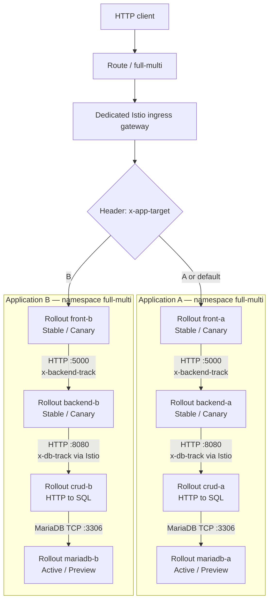

# full-multi — Eight-Rollout Bookshelf Demo on OpenShift

`full-multi` is a GitOps-managed, multi-tier Bookshelf demonstration for **OpenShift,
Argo CD, Argo Rollouts, and OpenShift Service Mesh (Istio)**. It implements two
independent applications, **A** and **B**, in **one dedicated Kubernetes namespace,
`full-multi`**. The existing `full-single-service` and `bookshelf` namespaces are
not part of this installation.

The demo's main feature is **HTTP-header-directed routing at multiple tiers**.
It allows an HTTP client to request a particular application's Front revision,
Backend revision, and MariaDB track independently. Each application has Front, Backend, CRUD and MariaDB Rollouts, giving
**eight Rollouts** in total. The `prepare/start/promote` commands intentionally
continue to advance only Front, Backend, and MariaDB.

> **Status:** This is a lab/demo design. The manifests and scripts were checked
> offline; the six live rollout transitions, the container build in your
> environment, and the deployed tracing pipeline still require cluster testing.
> MariaDB uses disposable, isolated storage. **Do not deploy production data.**

## 1. Architecture



The Istio ingress gateway is shared across A/B, but the two four-tier stacks
have separate Pods, Services, database Secrets, and MariaDB instances. Front
and Backend use the same custom Bookshelf container image, with their behavior
selected by environment variables. MariaDB uses a separate database image.

### Kubernetes inventory

| Tier | Application A | Application B | Strategy | Application port |
|---|---|---|---|---|
| Front | `front-a` | `front-b` | Istio canary | HTTP 3000 |
| Backend | `backend-a` | `backend-b` | Istio canary | HTTP 5000 |
| CRUD | `crud-a` | `crud-b` | Rolling update (canary) | HTTP 8080 |
| MariaDB | `mariadb-a` | `mariadb-b` | Blue-green | TCP 3306 |

The deployment declares **eight Rollouts**: four HTTP canaries, two CRUD
rolling-update Rollouts and two database blue-green Rollouts. Each has `-stable` and `-canary` Services (12 track Services).
Two backend anchor Services (`backend-a` and `backend-b`) provide
stable DNS names to which the internal Istio VirtualServices apply. Together
with the gateway Service and six CRUD Services, there are **21 Services** in the manifests.

Other shared resources include `Route/full-multi`,
`Deployment/full-multi-ingressgateway`, `Gateway/full-multi-gateway`,
`VirtualService/full-multi-front-router`, two internal backend VirtualServices,
four HTTP `AnalysisTemplate` resources, the two CRUD VirtualServices, and `Telemetry/full-multi-tracing`.

## 2. Request routing with HTTP headers

| Header | Values | Evaluated by | Effect |
|---|---|---|---|
| `x-app-target` | `a` / `b` | Istio ingress | `b` selects application B; missing or other values select A |
| `x-front-track` | `stable` / `canary` | Ingress VirtualService | Forces Front track; without it, use Argo Rollouts' weighted route |
| `x-backend-track` | `stable` / `canary` | Internal backend VirtualService | Forces Backend track; without it, use the independent weighted route |
| `x-db-track` | `blue` / `green` (also `stable` / `canary`) | CRUD Istio VirtualService | Selects BLUE or GREEN HTTP route; CRUD opens SQL to the matching MariaDB Service |

Routing selection is **per HTTP request**, not a deployment-wide setting.
The Front application explicitly forwards `x-backend-track` and `x-db-track`
when it makes an HTTP request to the Backend. Istio does not automatically
propagate arbitrary application headers across separately created HTTP calls.

`x-db-track` is forwarded over HTTP from Front to Backend to the CRUD
VirtualService. Istio selects the BLUE/GREEN logical CRUD Service and overwrites
`x-crud-db-target` to `stable`/`canary`. The CRUD pod alone opens the native
MariaDB TCP connection. A missing/unrecognized database track defaults to BLUE.

Forced `canary` / database-preview routes are usable **only when their candidate
Pods are running and ready**. If no candidate endpoint exists, a `503` is
possible. Omitting the Front/Backend track headers lets Argo Rollouts manage
the weights; at a fully prepared baseline these are expected to be 100% stable.

## 3. Images, application behavior, and data

The adapted Bookshelf image is:

```text
ghcr.io/gstephan76/argo-sm-bookshelf:full-multi-v1
```

`ROLE=front` serves HTTP on port `3000`, renders a Bookshelf HTML page at `/`,
and forwards `/api/books` requests to its application's Backend. `ROLE=backend`
serves HTTP on port `5000`, queries the CRUD HTTP service, and returns JSON including the
selected application, database track, database host, and backend prefix.
The Front/Backend image is **not** a byte-for-byte copy of the original
`quay.io/gstephan/frontend:latest` and `quay.io/gstephan/backend:latest` images;
it is an adapted demonstration implementing these header-routing semantics.

The sample database is `bookdb`, accessed by user `bookapp`, and contains
three sample books inserted by CRUD on its first successful SQL query.
Each application's CRUD pod reads its database credentials from an independent Secret:
`db-credentials-a` or `db-credentials-b`.

**Database lifecycle and safety:** `mariadb-a` and `mariadb-b` are Rollouts using
`quay.io/sclorg/mariadb-1011-c9s:latest`, `autoPromotionEnabled: false`, and
**`emptyDir`** for their data directories. The active and preview database Pods
have different ephemeral storage; they do not share a writable PVC. Promotion,
pod replacement, or scale-down can discard demo data. There is no data replication,
backup, migration, or persistence contract. MariaDB blue-green is provided to
exercise routing and operational demonstrations, **not as a production database
upgrade pattern**.

## 4. Prerequisites

- A working OpenShift cluster with Argo CD / OpenShift GitOps and Argo Rollouts
  installed, including the `oc argo rollouts` command.
- OpenShift Service Mesh / Istio gateway injection and sidecar injection enabled
  for namespaces labeled with `istio-discovery: enabled` and
  `istio-injection: enabled`.
- A clean checkout of [`gstephan76/argo-sm`](https://github.com/gstephan76/argo-sm)
  on `main`, with Git permissions to commit/push updates.
- `oc`, `git`, `python3`, `curl`, and either Podman or Docker. `skopeo` is useful
  for testing unauthenticated access to GHCR.
- Sufficient cluster capacity for four HTTP canary pairs, two MariaDB
  blue-green Rollouts, the Istio gateway, and temporary analysis Jobs.
- A working `otel-tracing` provider **if** you want traces sent to Tempo; the
  manifests reference that provider but do not install the Collector or Tempo.

All eight Rollouts use `replicas: 1` as the steady-state desired count. During
canary/blue-green operations, additional revision Pods can coexist, including
two different database datasets.

## 5. Install into the `argo-sm` checkout

The `full-multi` application resides at `full-multi/`. Its GitOps Application
manifest is `argocd/application-full-multi.yaml`, and the scripts are in
`scripts/full-multi*.sh` / `scripts/full-multi*.py`.

If starting from the separately supplied `full-multi` distribution, unpack it
into the repository root **before** following the rest of this guide:

```bash
cd ~/Documents/POCs/argo-sm
git pull --ff-only origin main
unzip -n ~/Downloads/argo_sm_full_multi_6_rollouts_bookshelf.zip -d .
```

Validate before publishing or deploying:

```bash
python3 scripts/full-multi-spec.py verify
bash -n scripts/full-multi.sh
bash -n scripts/build-push-full-multi.sh
bash -n scripts/full-multi-secrets.sh
python3 -m py_compile scripts/full-multi-spec.py scripts/full-multi-history-reset.py
git diff --check
```

These checks validate the *manifests and scripts*, not the cluster's ability to
run the container image or the availability of MariaDB and Tempo.

### 5.1 Build and publish the shared Bookshelf image

The Rollout manifests reference GHCR. Publish the image before enabling GitOps
auto-sync, otherwise new candidate Pods can fail with `ErrImagePull`.

```bash
# Authenticate with Podman / Docker to GHCR first (do not paste tokens into Git).
bash scripts/build-push-full-multi.sh

# The public-pull test should succeed without registry credentials:
skopeo inspect --no-creds \
  docker://ghcr.io/gstephan76/argo-sm-bookshelf:full-multi-v1
```

The script accepts `GHCR_TOKEN` and `GHCR_USER` from private environment
variables. The registry package must be made public or appropriate image pull
Secrets must be configured. A successful local image build alone is **not**
evidence that OpenShift can pull it.

### 5.2 Configure database Secrets (outside Git)

The Secret script creates the namespace and exactly two database credential
Secrets without putting passwords in Git manifests:

```bash
read -rsp 'Bookshelf DB password: ' FULL_MULTI_DB_PASSWORD; echo
read -rsp 'MariaDB root password: ' FULL_MULTI_DB_ROOT_PASSWORD; echo
export FULL_MULTI_DB_PASSWORD FULL_MULTI_DB_ROOT_PASSWORD
bash scripts/full-multi-secrets.sh
unset FULL_MULTI_DB_PASSWORD FULL_MULTI_DB_ROOT_PASSWORD
```

Use distinct, sufficiently strong passwords. The supplied script uses the
values for A and B; if separate per-application passwords are required, modify
the Secret workflow deliberately and keep that change outside plaintext Git.

### 5.3 Commit and push GitOps sources

```bash
git add full-multi/ \
  argocd/application-full-multi.yaml \
  scripts/full-multi.sh \
  scripts/full-multi-spec.py \
  scripts/full-multi-secrets.sh \
  scripts/full-multi-history-reset.py \
  scripts/build-push-full-multi.sh

git diff --cached --check
git commit -m 'Add full-multi six-rollout Bookshelf GitOps deployment'
git push origin main
```

The scripts that change BLUE/YELLOW state require a clean tracked worktree,
`main`, and `HEAD == origin/main` before they create/push their own commits.
Do not run concurrent mutating commands against the same Git branch.

### 5.4 Deploy through Argo CD

```bash
INSTANCE=a bash scripts/full-multi.sh deploy
INSTANCE=a bash scripts/full-multi.sh status
```

`deploy` verifies both database Secrets, applies the dedicated Argo CD
Application, requests a hard refresh, and waits for `main` to synchronize.
It does **not** prove that all six Rollouts are Ready; inspect the Rollout,
Pod, and Event status separately. Argo CD is configured with automated sync,
pruning, and self-healing.

## 6. Prepare, start, and promote

The `INSTANCE` variable scopes a lifecycle command to application A or B;
each command affects its three tier Rollouts (`front`, `backend`, `mariadb`).
The *other* application's Rollouts should not be advanced by those lifecycle
commands, although both still belong to the same GitOps Application.

| Command | Effect |
|---|---|
| `validate` | Offline check of the six-Rollout manifest contracts |
| `deploy` | Create/sync Argo CD Application for `full-multi` |
| `prepare` | Commit BLUE manifests, synchronize, complete/promote baseline Rollouts as required, then clear completed history for the selected three Rollouts |
| `start` | Commit YELLOW candidate manifests; wait for Front/Backend final canary pauses and MariaDB preview pause |
| `promote` | Promote the selected application's three Rollouts and wait for Healthy |
| `traffic` | Generate HTTP requests with header-directed track choices |
| `status` | Display all Rollouts, Services, VirtualServices, and the Route |

Example, **Application A**:

```bash
INSTANCE=a bash scripts/full-multi.sh prepare
INSTANCE=a bash scripts/full-multi.sh start
INSTANCE=a bash scripts/full-multi.sh promote
```

Then **Application B**:

```bash
INSTANCE=b bash scripts/full-multi.sh prepare
INSTANCE=b bash scripts/full-multi.sh start
INSTANCE=b bash scripts/full-multi.sh promote
```

`prepare` is destructive with respect to **completed historical AnalysisRuns and
old scaled-down ReplicaSets** belonging to the selected application's Rollouts.
It protects the active BLUE revision and refuses to clean up live old replicas
or running AnalysisRuns. It does not reset numeric revision history and it does
not delete arbitrary Job/Pod logs or resources owned by the other application.

**Important:** The blue-green MariaDB preview/promotion conditions in these
scripts still require verification against your installed Argo Rollouts
version. A failed `prepare`/`start`/`promote` is not proof that all three tiers
were completed; inspect each Rollout.

## 7. Run traffic and verify header choices

Get the one public endpoint:

```bash
NS=full-multi
HOST="$(oc get route full-multi -n "$NS" -o jsonpath='{.spec.host}')"
URL="https://${HOST}/"
```

Query **A, fully stable**:

```bash
curl -kfsS \
  -H 'x-app-target: a' \
  -H 'x-front-track: stable' \
  -H 'x-backend-track: stable' \
  -H 'x-db-track: stable' \
  "$URL"
```

Query **B, fully candidate/preview** (requires those revision Pods to exist):

```bash
curl -kfsS \
  -H 'x-app-target: b' \
  -H 'x-front-track: canary' \
  -H 'x-backend-track: canary' \
  -H 'x-db-track: canary' \
  "$URL"
```

For machine-readable response evidence, use `/api/books`:

```bash
curl -kfsS \
  -H 'x-app-target: b' \
  -H 'x-front-track: stable' \
  -H 'x-backend-track: canary' \
  -H 'x-db-track: stable' \
  "${URL}api/books"
```

The Backend JSON includes `application`, `backend`, `database_track`,
`database_host`, and the `books` array. The Front `/info` and Backend `/info`
endpoints expose each component's `MESSAGE_PREFIX` to help distinguish
BLUE and YELLOW Pods.

Generate repeated traffic with the repository's script:

```bash
INSTANCE=b REQUESTS=50 \
  FRONT_TRACK=stable BACKEND_TRACK=canary DB_TRACK=stable \
  bash scripts/full-multi.sh traffic
```

For normal progressive-rollout testing, omit forced Front/Backend track headers
in direct `curl` traffic so that Istio's programmed weights determine traffic
splitting. The `traffic` script always injects its chosen tracks; setting them
to `stable` intentionally bypasses the weighted canary split.

## 8. Watch rollout stages and Istio routing

```bash
oc get rollouts.argoproj.io -n full-multi
oc get pods -n full-multi -o wide
oc get svc -n full-multi
oc get virtualservices.networking.istio.io -n full-multi
oc get route full-multi -n full-multi
```

Inspect a particular tier and its staged analysis:

```bash
oc argo rollouts get rollout front-b -n full-multi --watch
oc argo rollouts get rollout backend-b -n full-multi --watch
oc argo rollouts get rollout mariadb-b -n full-multi --watch
oc get analysisruns.argoproj.io -n full-multi
```

Check the Istio-managed **default weighted routes** (separate from explicit
`*-force-stable` / `*-force-canary` header matches):

```bash
oc get virtualservice full-multi-front-router -n full-multi -o json |
  jq -r '.spec.http[] | select(.name=="primary" or .name=="secondary") |
         [.name, (.route[0].weight|tostring), (.route[1].weight|tostring)] | @tsv'

oc get virtualservice backend-b-router -n full-multi -o json |
  jq -r '.spec.http[] | select(.name=="backend-b-default") |
         [.name, (.route[0].weight|tostring), (.route[1].weight|tostring)] | @tsv'
```

Each Front/Backend canary declares **five analysis gates**, with 15 HTTP probes
per gate, for the 10%, 25%, 50%, 75%, and 100% weighted steps. The job checks
that the candidate's `/info` reports its expected BLUE/YELLOW prefix and that
`/api/books` responds with Bookshelf data. There is a final manual pause.

## 9. OpenTelemetry, Tempo, and Kiali

`full-multi/telemetry.yaml` requests **100% sampling** from the existing Istio
extension provider named `otel-tracing`, scoped to namespace `full-multi`.
It does **not** deploy or repair an OpenTelemetry Collector or TempoStack, and
100% sampling cannot fix a broken exporter, missing tenant, or blocked network
connection.

Istio proxies can create spans for HTTP connections through the gateway and
sidecars. The adapted Go Front currently forwards only the routing headers to
its Backend. It does **not** explicitly inject or propagate OpenTelemetry trace
context; therefore, **one connected end-to-end trace containing all tiers is
not guaranteed**. MariaDB uses TCP: its SQL operations do not produce native
application database spans without added instrumentation. Kiali metrics and
Istio traces are different telemetry pipelines.

Verify the control-plane extension provider, Telemetry policy, and Collector
counters before diagnosing missing traces as an application routing error:

```bash
oc -n istio-system get istio default -o json |
  jq '.spec.values.meshConfig | {enableTracing, extensionProviders}'
oc get telemetries.telemetry.istio.io -A
oc get opentelemetrycollectors.opentelemetry.io -A
oc get tempostacks.tempo.grafana.com -A
```

For HTTP request metadata, inspect Envoy metrics via Istio and trace exports
through the Collector; use OpenShift Network Observability to inspect the
Backend-to-MariaDB TCP flow if it is installed.

## 10. Troubleshooting

| Symptom | What to check |
|---|---|
| `ErrImagePull` / `403 Forbidden` | Publish `ghcr.io/gstephan76/argo-sm-bookshelf:full-multi-v1`; make the package public or set valid image pull credentials |
| `503` for `x-front-track: canary` | Is `front-a-canary` / `front-b-canary` backed by a Ready candidate Pod? |
| `503` for `x-backend-track: canary` | Check the backend canary Service endpoints, the internal VirtualService, and the backend Pod readiness |
| `database unavailable` / HTTP `503` | Verify DB Pod readiness, selected MariaDB Service endpoints, and `db-credentials-{a,b}` Secret |
| `start` times out | Check all three Rollouts independently, particularly MariaDB's blue-green preview availability and Front/Backend AnalysisRuns |
| `prepare` ends with history-reset error | The baseline or an old ReplicaSet/AnalysisRun is not yet safe to clean up; inspect Rollout and analysis status rather than force deleting |
| Kiali shows metrics but Tempo shows no traces | Confirm mesh `otel-tracing` provider, applicable Telemetry, Collector received/sent spans, Tempo tenant/query window |

Useful commands:

```bash
oc get pods -n full-multi
oc get events -n full-multi --sort-by=.lastTimestamp | tail -40
oc get endpointslices.discovery.k8s.io -n full-multi
oc get secret db-credentials-a -n full-multi -o name
oc get secret db-credentials-b -n full-multi -o name
```

Avoid printing Secret data, and do not delete current ReplicaSets or database
Pods just to clear an analysis failure. Run `prepare`, `start`, and `promote`
serially, not concurrently.

## 11. Repository structure

```text
argo-sm/
├── argocd/
│   └── application-full-multi.yaml
├── full-multi/
│   ├── README.md                  # This guide
│   ├── namespace.yaml
│   ├── gateway.yaml               # Ingress Deployment, Service, Gateway, Route
│   ├── front-virtualservice.yaml
│   ├── backend-{a,b}-virtualservice.yaml
│   ├── rollout-{front,backend,mariadb}-{a,b}.yaml
│   ├── service-*.yaml
│   ├── analysis-{front,backend}-{a,b}.yaml
│   ├── telemetry.yaml
│   ├── kustomization.yaml
│   └── bookshelf/
│       ├── Containerfile
│       ├── go.mod
│       ├── main.go
│       └── main_test.go
└── scripts/
    ├── full-multi.sh
    ├── full-multi-spec.py
    ├── full-multi-secrets.sh
    ├── full-multi-history-reset.py
    └── build-push-full-multi.sh
```

**Scope:** This README documents the six-Rollout `full-multi` demo only. The
`full-single-service` demo and its helper scripts remain independent.

## CRUD proxy architecture update

The backends now call independent HTTP CRUD proxies via `CRUD_API_URL`. Istio `crud-{a,b}-router` reads `x-db-track` and directs each request to the BLUE or GREEN logical CRUD Service, injecting an internal SQL-target header. CRUD alone owns SQL credentials and MariaDB TCP. See [CRUD-TIER.md](CRUD-TIER.md) for the architecture, build order, operational checks and the eight-Rollout inventory.
