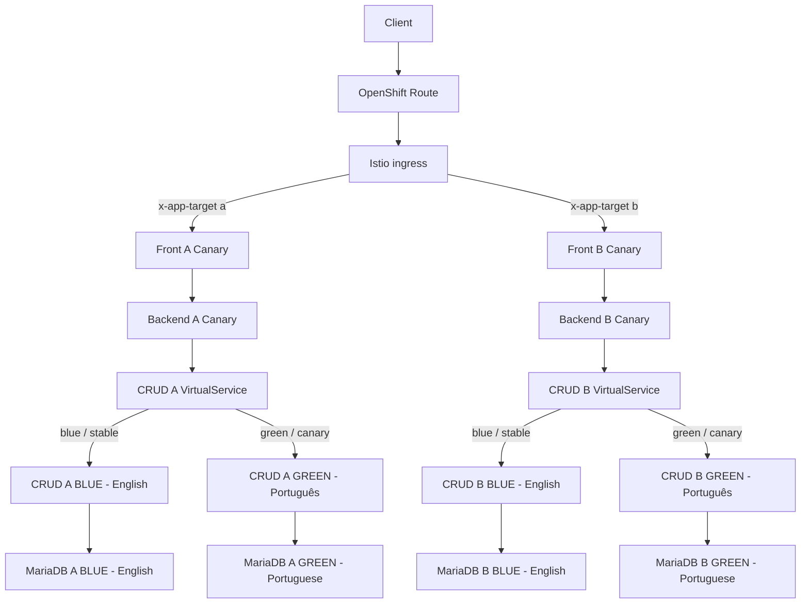

# full-multi — Front/Backend Canary + CRUD BlueGreen + independent MariaDB datasets

This is the canonical architecture and operations guide for the OpenShift
`full-multi` demonstration in `gstephan76/argo-sm` (`main`). It consists of two
independent application lanes, A and B, inside namespace `full-multi`.
The cluster-facing manifest is `argocd/application-full-multi.yaml`, whose
automated sync uses pruning and self-healing.

> **Migration warning — read before pushing:** The previous deployment had
> eight Argo Rollouts, including `mariadb-a/b` with ephemeral `emptyDir`
> datasets. This design has **six Rollouts** (four Canary, two CRUD BlueGreen)
> and **four MariaDB StatefulSets** (separate persistent volumes). Argo CD
> will prune the two obsolete MariaDB Rollouts and their associated Services
> after the new manifests sync. Their ephemeral data will **not** be copied.
> Only proceed with an approved demo reset. Never run on production data.

## 1. Architecture



The two CRUD Rollouts are **Argo Rollouts BlueGreen**. Each revision's pod
template binds `DB_HOST` to exactly **one** database and exposes its actual
`DB_TRACK`. The database is **not selected by an HTTP header inside CRUD**.
Istio uses the `x-db-track` header to select the *CRUD HTTP pod revision*.
Each MariaDB instance has its own StatefulSet, headless Service, and PVC.

| Tier | A / B controllers | Delivery strategy | Data |
|---|---|---|---|
| Front | `front-a`, `front-b` | Canary: 10%, 25%, 50%, manual pause | HTTP |
| Backend | `backend-a`, `backend-b` | Canary: 10%, 25%, 50%, manual pause | HTTP |
| CRUD | `crud-a`, `crud-b` | BlueGreen: manual promotion | Separate English/Portuguese SQL endpoint per revision |
| MariaDB | four `mariadb-{a,b}-{blue,green}` StatefulSets | Ordinary persistent workloads | Independent English or Brazilian Portuguese books |

### Three different meanings of track

`x-front-track` and `x-backend-track` refer to independent Canary
stable/canary revisions. They are **unrelated** to the database language.

For CRUD HTTP routing:

| `x-db-track` | Selected CRUD Service | Actual data |
|---|---|---|
| `blue` or `stable` | `crud-{a,b}-blue` (fixed BLUE selector) | English MariaDB `mariadb-{a,b}-blue` |
| `green` or `canary` | `crud-{a,b}-green` (fixed GREEN selector) | Portuguese MariaDB `mariadb-{a,b}-green` |
| omitted | `crud-{a,b}-active` (Argo Rollouts selector) | Whichever revision is promoted |

Backend sends traffic to the existing `crud-{a,b}-blue` *routing host*;
Istio's `crud-{a,b}-router` VirtualService redirects it to the correct
destination. Active/preview Services (`crud-{a,b}-active` and
`crud-{a,b}-preview`) are **different** from fixed language Services.
Because BlueGreen scales old ReplicaSets down after a delay (300s), a
fixed Blue route may return HTTP 503 after Green promotion. Likewise Green
does not exist until a Green candidate is started. This is not a promise
that both CRUD colors remain continuously available. For the currently
promoted language, **omit** `x-db-track`.

## 2. Prerequisites and images

Requires OCP with Service Mesh/Istio, Argo CD (OpenShift GitOps), cluster-scoped
Argo Rollouts controller, a default dynamic StorageClass, and four MariaDB
PVCs. Scripts require `oc`, `git`, `python3`, `curl` and `jq`. Build needs
Podman/Docker, and validation additionally supports `go` and `skopeo`.

The new application image is:

```text
ghcr.io/gstephan76/argo-sm-bookshelf:full-multi-crud-v4
```

It changes CRUD from per-request SQL selection to one immutable
`DB_HOST`/`DB_TRACK` binding per pod. Build and publish **before** the
GitOps manifest commit:

```bash
cd ~/Documents/POCs/argo-sm
bash scripts/build-push-full-multi-crud.sh
skopeo inspect --no-creds docker://ghcr.io/gstephan76/argo-sm-bookshelf:full-multi-crud-v4
```

Also verify both database images are pullable:

```bash
skopeo inspect --no-creds docker://ghcr.io/gstephan76/argo-sm-mariadb:english-literature-20-v1
skopeo inspect --no-creds docker://ghcr.io/gstephan76/argo-sm-mariadb:classicos-brasileiros-20-v1
```

Database credentials are **not** committed. Both A database StatefulSets
use `db-credentials-a`; both B database StatefulSets use `db-credentials-b`.
Their PVCs and data remain independent. Initialize credentials before
creating the databases:

```bash
bash scripts/full-multi-secrets.sh
oc -n full-multi get secret db-credentials-a db-credentials-b
oc get storageclass
```

`full-multi-secrets.sh` preserves existing Secrets; do not rotate Secrets
on initialized databases without also rotating SQL users.

## 3. Approved migration from the existing eight-Rollout cluster

**Do not just push the new manifests** into a live, non-disposable cluster.
Argo CD automated prune removes `Rollout/mariadb-a` and `Rollout/mariadb-b`;
their `emptyDir` contents are unrecoverable after Pod termination.

1. Inspect current state and make an explicit demo-data reset decision:

   ```bash
   oc -n full-multi get rollout
   oc -n full-multi get pods,pvc
   oc -n openshift-gitops get application full-multi -o yaml
   ```

2. Verify credentials, default StorageClass, and publish the new CRUD image.
   Four new databases need storage. They have **new PVC identities** and
   never attach to the old MariaDB Rollout Pods.

3. Stage the four databases **before changing GitOps**. This script creates
   only the four new MariaDB Services and StatefulSets; it does not delete
   or promote the old Rollouts:

   ```bash
   bash scripts/full-multi-databases.sh --apply
   oc -n full-multi get statefulsets
   oc -n full-multi get pvc
   ```

4. Verify each StatefulSet is Ready, the PVCs are `Bound`, and both images
   initialized their separate language-specific datasets. The staging
   script blocks until the four StatefulSets become Ready, but an SQL
   query through the new CRUD path is the definitive dataset check.

5. Test the source modifications locally:

   ```bash
   python3 scripts/full-multi-spec.py verify
   bash -n scripts/full-multi.sh scripts/full-multi-databases.sh
   python3 -m py_compile scripts/full-multi-spec.py scripts/full-multi-bootstrap.py scripts/full-multi-history-reset.py scripts/full-multi-history-prune.py
   (cd full-multi/bookshelf && go test ./...)
   oc kustomize full-multi >/dev/null
   git diff --check
   ```

6. Review the Argo CD prune consequences and **explicitly authorize** the
   demo cutover. Push the modified `full-multi/`, `scripts/` and the
   Argo CD Application YAML to `main`. GitOps sync will adopt the staged
   StatefulSets, apply the new CRUD Rollout templates/Services, and prune
   the obsolete MariaDB Rollouts/track Services. This can be disruptive;
   it is not an in-place preservation of ephemeral database data.

   ```bash
   git status --short
   git diff --stat
   # Stage only intended full-multi files, not unrelated projects:
   git add full-multi/ scripts/full-multi.sh scripts/full-multi-spec.py \
     scripts/full-multi-bootstrap.py scripts/full-multi-history-reset.py \
     scripts/full-multi-history-prune.py scripts/full-multi-databases.sh \
     scripts/build-push-full-multi-crud.sh argocd/application-full-multi.yaml
   git diff --cached --check
   git commit -m 'Make full-multi CRUD BlueGreen with isolated language databases'
   git push origin main
   ```

   **Do not commit if the new CRUD image is not pullable.** The original
   paused MariaDB Rollouts should not be manually deleted before the
   replacement workloads and CRUD routing are proven.

7. Verify Argo CD synchronization, database readiness, and new CRUD
   active endpoints. A BlueGreen strategy change on an already-paused
   CRUD Rollout might require a coordinated lab reset; do not force-delete
   ReplicaSets or volumes to suppress an error.

   ```bash
   oc -n openshift-gitops get application full-multi
   oc -n full-multi get rollout
   oc -n full-multi get statefulset,pvc,svc
   oc -n full-multi get endpointslice -l kubernetes.io/service-name=crud-a-active
   oc -n full-multi get endpointslice -l kubernetes.io/service-name=crud-a-blue
   ```

## 4. Demo lifecycle (A and B independently)

The script `scripts/full-multi.sh` keeps the original Front/Backend
50%-pause canary contract. CRUD is now the third managed Rollout;
MariaDB is never promoted through Argo Rollouts.

```bash
INSTANCE=a bash scripts/full-multi.sh validate
INSTANCE=a bash scripts/full-multi.sh deploy
INSTANCE=a bash scripts/full-multi.sh prepare
INSTANCE=a bash scripts/full-multi.sh start
INSTANCE=a bash scripts/full-multi.sh status
bash scripts/full-multi-validate-data-paths.sh --preview
INSTANCE=a bash scripts/full-multi.sh promote
```

Repeat with `INSTANCE=b` when desired. Commands are intentionally serial.
`prepare` makes the selected CRUD BLUE (English), with Front/Backend BLUE
and complete stable Rollouts. `start` makes CRUD GREEN (Portuguese) as
a **paused preview**, while Front/Backend canaries advance to 50% and
pause. `promote` switches CRUD's active Service to Green, then promotes
Backend and Front. The four MariaDB StatefulSets keep running throughout.

`prepare` and `start` make and push **Git commits** and wait for Argo CD.
They require a clean tracked `main` with `HEAD==origin/main`; do not run
these while another developer is modifying the same branch. The script
prunes only safe obsolete rollout history; it does not delete database
PVCs. `deploy` only waits for a fresh settled installation; a demo already
paused during rollout should be diagnosed from `status` rather than
blindly reset.

## 5. Manual HTTP/SQL-path validation

```bash
HOST="$(oc -n full-multi get route full-multi -o jsonpath='{.spec.host}')"
for app in a b; do
  for language in blue green; do
    echo "=== application=$app CRUD=$language ==="
    curl -kfsS -H "x-app-target: $app" \
      -H 'x-front-track: stable' -H 'x-backend-track: stable' \
      -H "x-db-track: $language" \
      "https://${HOST}/api/books" | \
      jq '{application, frontend_release, backend_release, database_track, database_host, count:(.books|length), first_book:(.books[0].title)}'
  done
done
```

During paused preview expect BLUE → `mariadb-a-blue` / English
(`Pride and Prejudice`) and GREEN → `mariadb-a-green` / Portuguese
(`Memórias Póstumas de Brás Cubas`), and equivalently for B.
Inspect the actual `database_host`, not the requested `x-db-track` header
alone. The SQL connection is TCP, and the two DBs do not synchronize.

The default promoted route after `promote` is tested **without**
`x-db-track`:

```bash
curl -kfsS -H 'x-app-target: a' \
  -H 'x-front-track: stable' -H 'x-backend-track: stable' \
  "https://${HOST}/api/books" | \
  jq '{database_track,database_host,first_book:.books[0].title}'
```

Test the rollout controllers and independent database Services:

```bash
oc argo rollouts list rollout -n full-multi
oc argo rollouts get rollout crud-a -n full-multi
oc -n full-multi get sts mariadb-a-blue mariadb-a-green mariadb-b-blue mariadb-b-green
oc -n full-multi get svc crud-a-blue crud-a-green crud-a-active crud-a-preview
oc -n full-multi get endpointslices.discovery.k8s.io
```

## 6. Observability and limitations

Tracing still uses the existing Istio `otel-tracing` extension provider,
OTel Collector, TempoStack, and Kiali. Front and Backend propagate W3C
context to downstream HTTP. MariaDB speaks SQL/TCP; Envoy tracing does not
generate SQL statement spans without database client instrumentation.

```bash
bash scripts/check-full-multi-tracing.sh
python3 scripts/full-multi-spec.py verify
```

The four databases do **not** replicate. Promotion switches the CRUD
application/database path; it does **not** migrate writes between SQL
instances. Persistent volumes preserve each separate dataset across Pod
restarts, but removal/formatting of a PVC destroys that dataset.

## 7. Troubleshooting

| Symptom | Check |
|---|---|
| Green HTTP 503 | `crud-{a,b}-green` EndpointSlice and paused CRUD preview |
| Blue HTTP 503 after promotion | Expected once the old Blue CRUD ReplicaSet scales down; omit `x-db-track` for the promoted path |
| Database unavailable | `oc -n full-multi get sts,pvc,pods`; wrong DB_HOST, missing Secret, or PVC Pending |
| Green shows English | Validate `DB_TRACK/DB_HOST` in **serving** CRUD pod and pre-seeded data in the Green DB PVC |
| ImagePullBackOff | Publish the new `full-multi-crud-v4` image before GitOps cutover |
| Argo CD sync failure | Check app sync, resource health, prune ordering and ownership conflicts |
| `start` does not pause | Inspect CRUD BlueGreen preview and Front/Backend canary steps independently |
| Kiali shows no MySQL spans | SQL/TCP lacks application-level DB tracing by default |

Additional background docs (`BOOTSTRAP.md`, `CRUD-TIER.md`,
`MARIADB-ENGLISH-BLUE-PORTUGUESE-GREEN.md`, `MARIADB-CLASSICS.md`)
describe earlier stages of the demo. This README is authoritative for
the **six-Rollout / four-StatefulSet** topology.
