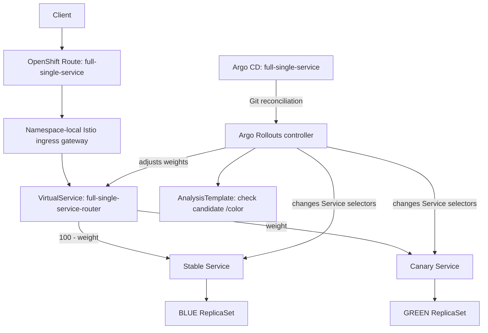

# full-single-service — Istio canary using the Blue/Green demo application

This is **a second, isolated demo** in `gstephan76/argo-sm`. It does not replace
`full-demo/`, does not use Bookinfo, and does not modify the old
`gstephan76/argocd-bluegreen` repository.

It reuses the **application** from that repository's `bluegreen-demo`:

- `argoproj/rollouts-demo:blue` (trusted baseline)
- `argoproj/rollouts-demo:green` (candidate)
- HTTP `/color` returns JSON string `"blue"` or `"green"`

**Important strategy distinction:** The original `bluegreen-demo` uses an Argo
Rollouts `blueGreen` strategy with Active/Preview Services. This new demo uses
**Istio-weighted Argo Rollouts Canary** to showcase the Service Mesh integration
already demonstrated by `full-demo`. The image is the same; the deployment
strategy intentionally differs.

| Property | Setting |
| --- | --- |
| Namespace | `full-single-service` |
| Argo CD Application | `full-single-service` in `openshift-gitops` |
| Rollout | `full-single-service` (4 replicas) |
| Ingress Route | `full-single-service` |
| Istio VirtualService | `full-single-service-router`, route `primary` |
| Stable/Canary Services | `full-single-service-stable` / `full-single-service-canary` |
| Progression | 10% → 25% → 50% → 75% → 100% |
| Analysis gates | Job-based HTTP and `/color` check after each weight |
| Final gate | Manual Argo Rollouts promotion |

## Architecture



Argo CD ignores **only** the dynamic `rollouts-pod-template-hash` selectors and
`primary` HTTP-route destination weights. Everything else remains Git-managed.
The Istio workload injection and isolated gateway follow the current
`full-demo` design. Unlike Bookinfo, there are no details/reviews/ratings
services or blackbox/downstream-chain Prometheus analyses: each canary gate
runs a bounded Kubernetes Job against the candidate Service `/color` endpoint.

## Prerequisites

- OpenShift with OpenShift Service Mesh 3.4+ (`Istio/default` and
  `IstioCNI/default` Ready, and namespace discovery label accepted)
- OpenShift GitOps and Argo Rollouts controller/operator installed
- `oc` and `oc argo rollouts` installed; `git`, `python3`, `curl`
- Permission to create the namespace and Argo CD Application
- This repository checked out at `main` and pushed to `origin/main`
- Argo CD access to `https://github.com/gstephan76/argo-sm.git`

These files only **describe** the namespace. No resources are created until an
operator explicitly runs the `deploy` demo command (or applies the manifests
through their existing GitOps workflow). This is separate from the Git-only
repository migration scripts.

## Operator workflow

From the root of the `argo-sm` checkout, first inspect and commit the new files:

```bash
bash scripts/full-single-service.sh validate
# Optional: kustomize build full-single-service

git add argocd/application-full-single-service.yaml full-single-service \
        scripts/full-single-service.sh scripts/full-single-service-spec.py
git commit -m 'Add single-service Istio canary demo using rollouts-demo'
git push origin main
```

When you *choose* to deploy this isolated demo to a test cluster:

```bash
bash scripts/full-single-service.sh deploy
bash scripts/full-single-service.sh prepare
bash scripts/full-single-service.sh start
```

In another terminal, watch the candidate progress:

```bash
oc argo rollouts get rollout full-single-service \
  -n full-single-service --watch

oc get virtualservice full-single-service-router \
  -n full-single-service -o yaml
```

Traffic sampling across the single public Route (no special header is needed):

```bash
REQUESTS=200 bash scripts/full-single-service.sh traffic
```

After the five successful analysis gates, the Rollout pauses at 100% GREEN
traffic. Approve the final gate explicitly:

```bash
bash scripts/full-single-service.sh promote
```

Reset to a canonical BLUE baseline for the next live demonstration:

```bash
bash scripts/full-single-service.sh prepare
```

Live read-only status:

```bash
bash scripts/full-single-service.sh status
```

## Runtime / Git semantics

- `validate` is **offline** and never contacts a cluster.
- `deploy` explicitly creates/reconciles the **new demo's** Application in
  `openshift-gitops` and waits for Git sync; it does not install Service Mesh.
- `prepare` commits and pushes the canonical BLUE manifest, waits for the
  matching Argo CD revision, then promotes the verified BLUE spec if needed.
- `start` commits/pushes a fresh GREEN image and revision marker, and waits for
  the final canary pause. The smoke-test argument is updated to GREEN in the
  same Git revision as the image to prevent mismatched checks.
- `promote` verifies the candidate Git and Rollout marker and approves the
  manual pause; it never edits the manifests.
- `traffic` samples the externally exposed `/color` endpoint to show the
  observed BLUE/GREEN distribution, which varies statistically by sample size.
- The operator scripts refuse unexpected Git branches, a dirty tree, a
  mismatched remote, or an unsynchronized Git/Argo CD revision.

No existing `full-demo`, Bookinfo, or `bluegreen-demo` resources are reused or
modified; all new resource names and selectors are distinct.
