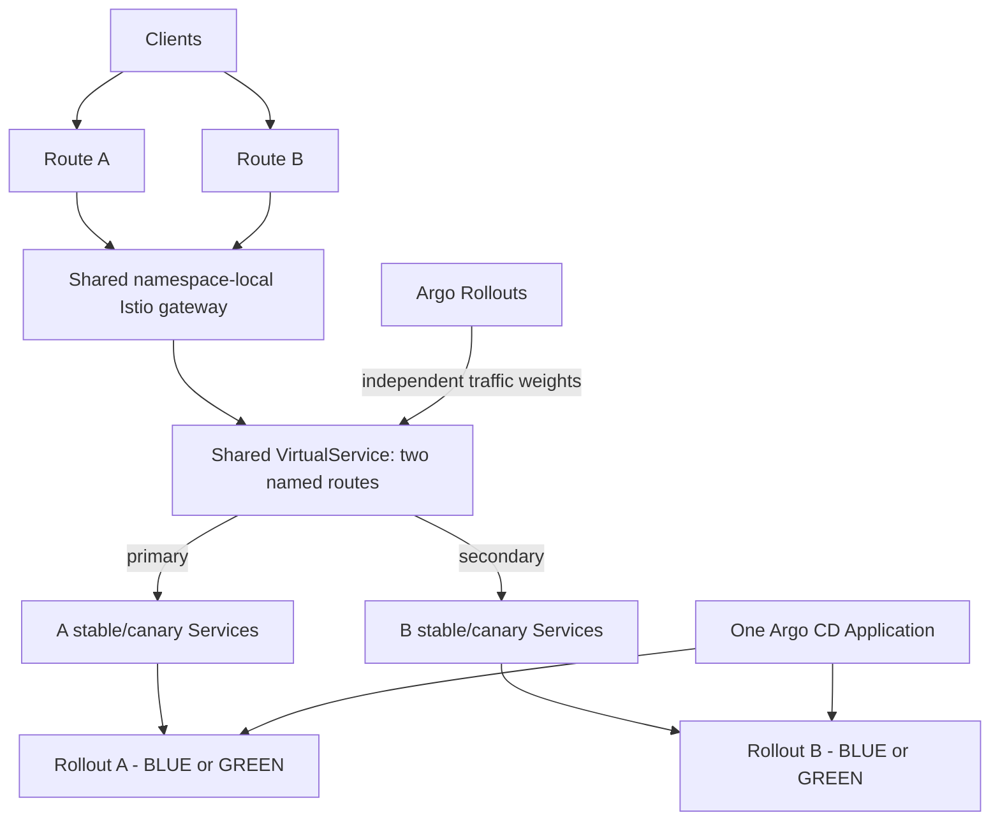

# full-single-service — two independent Istio canary applications in one namespace

This is **a second, isolated demo** in `gstephan76/argo-sm`. It does not replace
`full-demo/`, does not use Bookinfo, and does not modify the old
`gstephan76/argocd-bluegreen` repository.

It reuses the **application** from that repository's `bluegreen-demo`:

- `argoproj/rollouts-demo:blue` (trusted baseline)
- `argoproj/rollouts-demo:green` (candidate)
- HTTP `/color` returns JSON string `"blue"` or `"green"`

**Important strategy distinction:** The original `bluegreen-demo` uses an Argo
Rollouts `blueGreen` strategy with Active/Preview Services. This new demo uses
**Istio-weighted Argo Rollouts Canary** to showcase the Service Mesh integration
already demonstrated by `full-demo`. The image is the same; the deployment
strategy intentionally differs.

| Property | Setting |
| --- | --- |
| Namespace | `full-single-service` |
| Argo CD Application | `full-single-service` in `openshift-gitops` |
| Rollouts | `full-single-service` (A), `full-single-service-b` (B), 4 replicas each |
| Ingress Routes | `full-single-service` (A), `full-single-service-b` (B) |
| Istio VirtualService | `full-single-service-router`, named routes `primary` (A) and `secondary` (B) |
| Stable/Canary Services | One independent stable/canary Service pair per instance |
| Progression | 10% → 25% → 50% → 75% → 100% |
| Analysis gates | Job-based HTTP and `/color` check after each weight |
| Final gate | Manual Argo Rollouts promotion |

## Architecture



Argo CD ignores **only** the dynamic `rollouts-pod-template-hash` selectors and
`primary` and `secondary` HTTP-route destination weights. Everything else remains Git-managed.
The Istio workload injection and isolated gateway follow the current
`full-demo` design. Unlike Bookinfo, there are no details/reviews/ratings
services or blackbox/downstream-chain Prometheus analyses: each canary gate
runs a bounded Kubernetes Job against the candidate Service `/color` endpoint.

## Prerequisites

- OpenShift with OpenShift Service Mesh 3.4+ (`Istio/default` and
  `IstioCNI/default` Ready, and namespace discovery label accepted)
- OpenShift GitOps and Argo Rollouts controller/operator installed
- `oc` and `oc argo rollouts` installed; `git`, `python3`, `curl`
- Permission to create the namespace and Argo CD Application
- This repository checked out at `main` and pushed to `origin/main`
- Argo CD access to `https://github.com/gstephan76/argo-sm.git`

These files only **describe** the namespace. No resources are created until an
operator explicitly runs the `deploy` demo command (or applies the manifests
through their existing GitOps workflow). This is separate from the Git-only
repository migration scripts.

## Operator workflow

From the root of the `argo-sm` checkout, first inspect and commit the new files:

```bash
bash scripts/full-single-service.sh validate
# Optional: kustomize build full-single-service

git add argocd/application-full-single-service.yaml full-single-service \
        scripts/full-single-service.sh scripts/full-single-service-spec.py
git commit -m 'Expand full-single-service to two independent Istio canary Rollouts'
git push origin main
```

When you *choose* to deploy this isolated demo to a test cluster:

```bash
bash scripts/full-single-service.sh deploy
INSTANCE=a bash scripts/full-single-service.sh prepare
INSTANCE=b bash scripts/full-single-service.sh prepare
INSTANCE=b bash scripts/full-single-service.sh start
```

In another terminal, watch the candidate progress:

```bash
oc argo rollouts get rollout full-single-service \
  -n full-single-service --watch

oc get virtualservice full-single-service-router \
  -n full-single-service -o yaml
```

Traffic sampling across either public Route (no special header is needed):

```bash
REQUESTS=200 bash scripts/full-single-service.sh traffic
```

After the five successful analysis gates, the Rollout pauses at 100% GREEN
traffic. Approve the final gate explicitly:

```bash
bash scripts/full-single-service.sh promote
```

Reset to a canonical BLUE baseline for the next live demonstration:

```bash
bash scripts/full-single-service.sh prepare
```

Live read-only status:

```bash
bash scripts/full-single-service.sh status
```

## Runtime / Git semantics

- `validate` is **offline** and never contacts a cluster.
- `deploy` explicitly creates/reconciles the **existing demo's** Application in
  `openshift-gitops` and waits for Git sync; it does not install Service Mesh.
- `prepare` commits and pushes the canonical BLUE manifest, waits for the
  matching Argo CD revision, then promotes the verified BLUE spec if needed.
- `start` commits/pushes a fresh GREEN image and revision marker, and waits for
  the final canary pause. The smoke-test argument is updated to GREEN in the
  same Git revision as the image to prevent mismatched checks.
- `promote` verifies the candidate Git and Rollout marker and approves the
  manual pause; it never edits the manifests.
- `traffic` samples the externally exposed `/color` endpoint to show the
  observed BLUE/GREEN distribution, which varies statistically by sample size.
- The operator scripts refuse unexpected Git branches, a dirty tree, a
  mismatched remote, or an unsynchronized Git/Argo CD revision.

No existing `full-demo`, Bookinfo, or `bluegreen-demo` resources are reused or
modified; all new resource names and selectors are distinct.


## Dual application layout (A and B)

This same demo now contains **two independent Argo Rollouts**, as in the
`canary-mesh-multi-bookinfo` pattern. Both run `argoproj/rollouts-demo`
in namespace `full-single-service`; both can progress from BLUE to GREEN
without changing the other instance. There is **one Argo CD Application**
(`full-single-service`) owning the whole `full-single-service/` directory.

| | Instance A (existing) | Instance B (new) |
|---|---|---|
| Rollout | `full-single-service` | `full-single-service-b` |
| Route | `full-single-service` | `full-single-service-b` |
| Stable Service | `full-single-service-stable` | `full-single-service-b-stable` |
| Canary Service | `full-single-service-canary` | `full-single-service-b-canary` |
| AnalysisTemplate | `full-single-service-smoke-test` | `full-single-service-b-smoke-test` |
| Named VirtualService route | `primary` | `secondary` |

The single shared `full-single-service-router` VirtualService distinguishes
requests by the automatically generated OpenShift Route hostname; each named
HTTP route owns an isolated stable/canary weight pair. The matching patterns
assume OpenShift's standard `<route>-<namespace>.<apps-domain>` host naming.
If you use custom Route hostnames, update the VirtualService authority regexes
accordingly. Requests made directly to the gateway without either hostname
are intentionally **not** routed.

To manage the two Rollouts independently:

```bash
INSTANCE=a bash scripts/full-single-service.sh prepare
INSTANCE=b bash scripts/full-single-service.sh prepare
INSTANCE=b bash scripts/full-single-service.sh start
INSTANCE=b bash scripts/full-single-service.sh promote
INSTANCE=a bash scripts/full-single-service.sh start
```

To populate Kiali traffic graphs, run two concurrent traffic loops (from two
shells) for around 2 minutes, while Kiali graph duration is set to 5–10 minutes:

```bash
INSTANCE=a REQUESTS=600 TRAFFIC_INTERVAL_SECONDS=0.2 bash scripts/full-single-service.sh traffic
INSTANCE=b REQUESTS=600 TRAFFIC_INTERVAL_SECONDS=0.2 bash scripts/full-single-service.sh traffic
```

Run `INSTANCE=a|b bash scripts/full-single-service.sh status` to inspect each.
Kiali needs actual requests AND Prometheus scraping of Envoy `istio_requests_total`.
`podmonitor-istio-proxies.yaml` adds the namespace-local PodMonitor following
`full-demo` conventions, and the namespace-local gateway advertises Envoy
metrics on port 15090. Ensure OpenShift user-workload monitoring is enabled
and Kiali is configured to query the Prometheus/Thanos instance containing
these scraped metrics. The PodMonitor itself does not ensure Kiali uses them.

Read-only diagnostic commands:

```bash
oc get pod -n full-single-service -o custom-columns='NAME:.metadata.name,CONTAINERS:.spec.containers[*].name'
oc get podmonitor -n full-single-service
oc get route -n full-single-service
oc get virtualservice full-single-service-router -n full-single-service -o yaml
oc get kiali -A
```

In OpenShift Observe → Metrics, query:

```promql
sum by (destination_workload, destination_service_name) (
  rate(istio_requests_total{destination_workload_namespace="full-single-service"}[2m])
)
```

No deployment happens when generating/applying this Git patch. As the Argo CD
Application is auto-synced, **merging the patch into `main` can trigger a real
cluster reconciliation**, so review the changes before merging.
